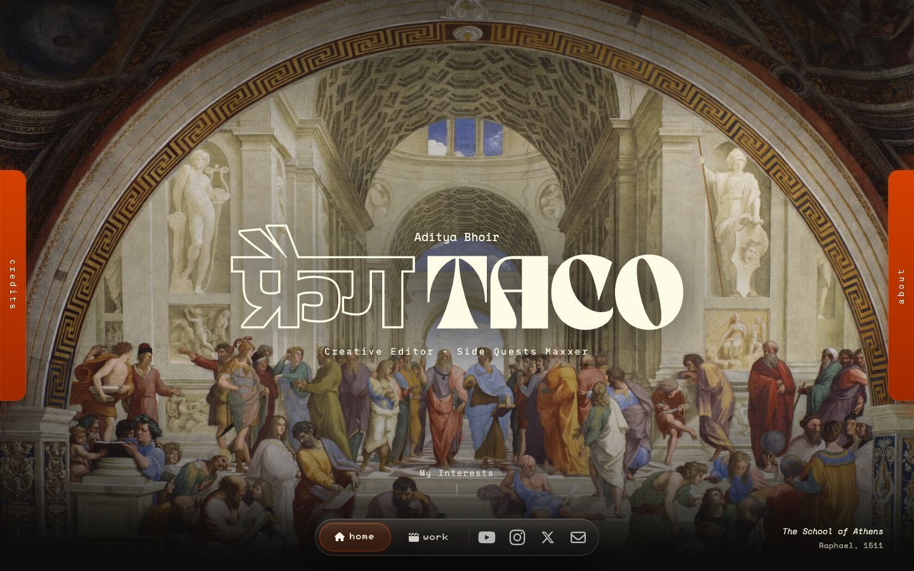
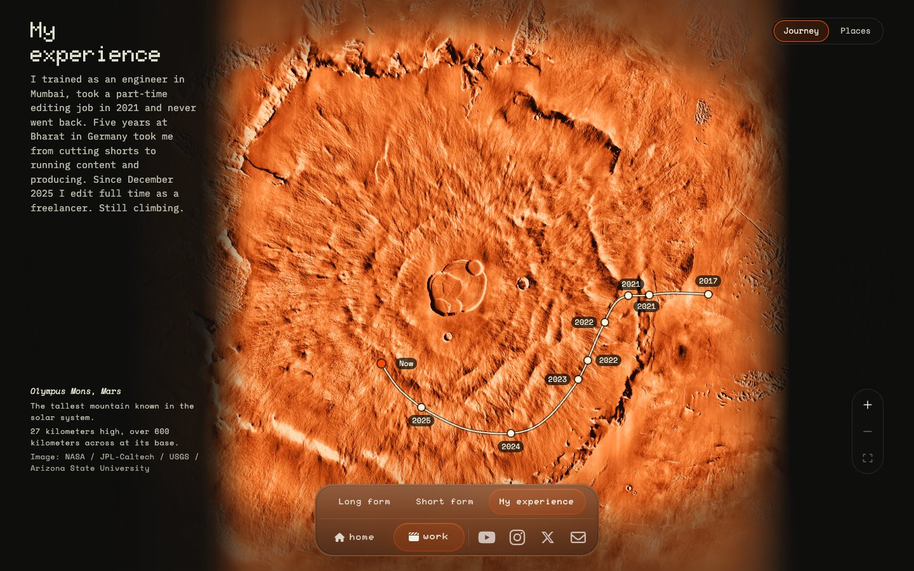
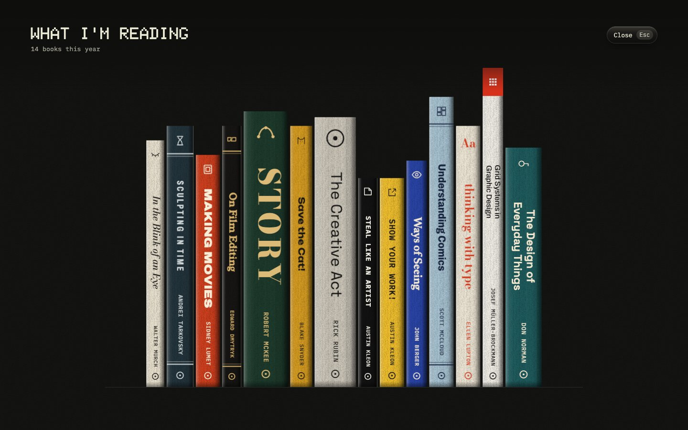
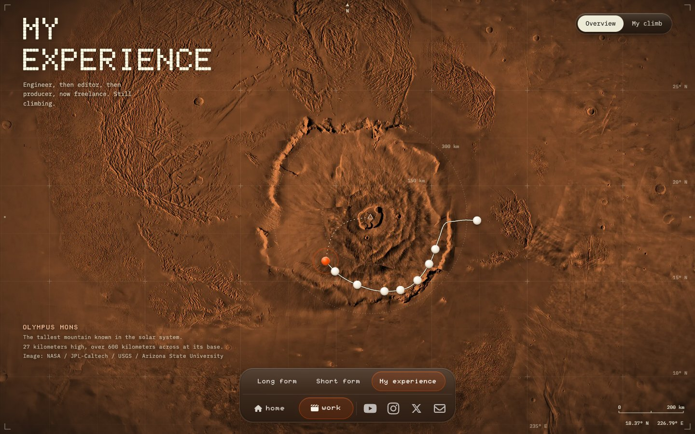
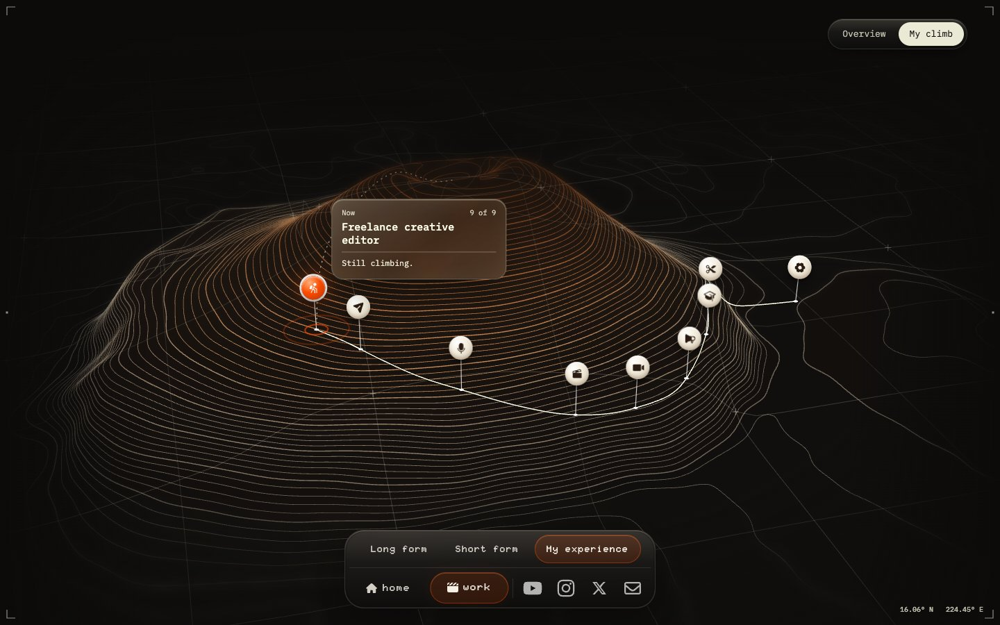
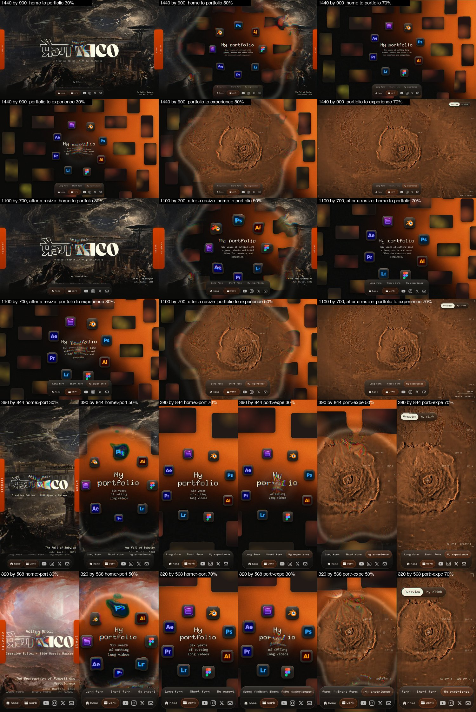

# Case study: redesigning the FragTaco portfolio

This is the story of how the personal site of Aditya Bhoir (FragTaco), a creative editor in Mumbai, went from an older Remix site to the redesigned one that went live on 18 November 2026. It is written for someone who was not there: what Aditya asked for in each round, what was built in response, what was tried and taken out, and how the site changed along the way.

The site is live at https://fragtaco-portfolio.vercel.app. The code is a Remix and React app; [the README](../README.md) says how to run it.

Every number below comes from a file in this repository, and each section says which. Where two files disagree, the later one is used and the text says so. The full record is [the feedback log](redesign/feedback-log.md) (about 1,000 lines, one section per round). This page is the short version of it. [The docs index](redesign/README.md) lists everything else.

## Contents

1. [The site at a glance, then and now](#the-site-at-a-glance-then-and-now)
2. [Where it started](#where-it-started)
3. [Round 0 and round 1: the brief and the first mockup (1 November)](#round-0-and-round-1-the-brief-and-the-first-mockup-1-november)
4. [Round 2 and round 3: v3 and v4, signed off (2 November)](#round-2-and-round-3-v3-and-v4-signed-off-2-november)
5. [Round 4: the built shelf and walls (5 November)](#round-4-the-built-shelf-and-walls-5-november)
6. [Round 5: audit, polish and the work page (11 November)](#round-5-audit-polish-and-the-work-page-11-november)
7. [Round 6: feedback on the built preview (11 to 13 November)](#round-6-feedback-on-the-built-preview-11-to-13-november)
8. [Round 7: previews, build and four follow-ups (12 to 17 November)](#round-7-previews-build-and-four-follow-ups-12-to-17-november)
9. [The modern web pass (16 to 18 November)](#the-modern-web-pass-16-to-18-november)
10. [The release (18 November)](#the-release-18-november)
11. [How the work was run](#how-the-work-was-run)
12. [Tried and taken out](#tried-and-taken-out)
13. [What is left for the owner](#what-is-left-for-the-owner)

## The site at a glance, then and now

| | Round 4 (5 November, the first public review link) | Released (18 November) |
| --- | --- | --- |
| Pages | The redesigned home page, and the work page from the older site | The home page, `/work` (My portfolio), `/work/long-form`, `/work/short-form` and `/experience` (My experience) |
| Home | Painting hero, two cards, two blocks, a 3D shelf and a video wall that opened as layers | The same scene, rebuilt: the two blocks hold the live shelf and wall, drawn small, and opening is one move |
| Work | The older work page, still as it was before the redesign | Four rings turning around a short intro, and two flat walls of videos |
| Experience | Not built | A map of Olympus Mons on Mars with a trail of nine milestones |
| Moving between pages | A plain page load | One slow radial reveal from the centre of the screen, with the hero painting's liquid at the edge |
| Fonts | Google's font servers | Eleven families served from the site itself |
| Security headers | None | A full set, with an enforced content policy |
| Tests | Not counted in the log | 2,561 tests in 187 files |

The tests row is from the end of the web pass ([the log's final status](redesign/feedback-log.md#the-modern-web-pass-final-status-18-november-2026)). Round 7 ended at 2,476 tests in 174 files.

## Where it started

Before this work, `main` held an older site. The only record of it is the commit history (July and August 2026) and the content files it had: a hero with a shuffling painting, a "fact shuffler", a row of editing tools, a reel page with a timeline drawn like a video editor's scrubber, and a clients section. It had two routes (the home page and `work`) and the page-view counter's endpoint. The history from 9 July to 30 August 2026 is numbered T1 to T7 and R1 to R23 in the commit subjects, so the redesign's commits carry on from R24.

The redesign did not start from that code. It started from a brief and a mockup, which is why this story starts with round 0.

## Round 0 and round 1: the brief and the first mockup (1 November)

Source: [feedback log, rounds 0 and 1](redesign/feedback-log.md#round-0-the-brief-2026-11-01).

**What he asked for (round 0).** A loader (the name, then the logo, then a liquid-glass refraction that reveals a painting). A hero with the name, logo and roles centred ("Creative Editor - Side Quests Maxxer"). Three directions out of the hero: right for an intro with a photo, left for Ohshin's credits, down for books and YouTube recommendations. A video section built from a 51-video YouTube playlist, and a 3D books section. The process was set at the start: design first, then a detailed build plan, then one pull request per part, with commits numbered on from R23.

**What was built.** Nothing yet. The first step was a mockup, [v1](redesign/mockups/home-v1.html), with two options each for the books and the videos.

**Round 1 feedback on v1.**
- The logo was cut off and sat in a box. It should be the two SVGs side by side in cream, the Devanagari word outlined and TACO filled.
- The side panels should be blocks that slide over a blurred hero, not separate pages.
- Books: take option B, the shelf, with real texture. Videos: option B, the fisheye wall, no duration stamps, a large wall that moves very slowly.
- The loader should grow from the centre, name first, then logo, then reveal, with paintings changing through liquid glass.
- Below the hero: two blocks, "What I am reading" and "What I am watching", each expanding into the real thing. He asked whether this was a good idea.

**What v2 did.** Rebuilt the logo, made the cards slide over a blurred hero with a breathing glow at the edges, gave the shelf cloth-grain spines and the wall a drifting surface of all 51 thumbnails, and built the two blocks with live peeks. The answer to his question was yes, with conditions: the peeks must show real content, the expansion must stay on the page, Esc, Close and Back must all return, each view gets its own link (`#reading`, `#watching`), and the heavy scenes load only when asked.

## Round 2 and round 3: v3 and v4, signed off (2 November)

Source: [feedback log, rounds 2 and 3](redesign/feedback-log.md#round-2-feedback-on-v2-2026-11-02).

His reaction to v2: "I am liking this new version much better than previous." Round 2's requests were mostly about detail: Space Mono for the name and caption (the serif was dropped from the interface), chevrons removed from the card rails, "Scroll for books and videos" becoming "My Interests", animations that felt sluggish, a place for the navigation dock, and a wall that no longer bends the video you look at.

v3 answered with a performance rewrite as much as a look change: no full-screen blur layer, a hero that redraws only when something moves, heavy scenes loading lazily, and per-book soft shadows instead of a shadow map. The log's measured table shows 8.3 to 8.4 ms average frames in every scenario, on a 120 Hz development Mac, and says plainly that this proves nothing about slower hardware.

Round 3 asked for: a two-column intro card with the photo on the left, nothing visible below the hero until the loader ends, the shelf small enough to show every book, slower and smoother book motion, and a faint glow on the logo. v4 did those and was signed off. It went into a design document and a build plan, and the build began the same day: R24 to R29 (foundations, hero and loader, cards and gestures, the blocks, the reading shelf, the watching wall) as pull requests #1 to #6.

## Round 4: the built shelf and walls (5 November)

Source: [feedback log, round 4](redesign/feedback-log.md#round-4-feedback-on-the-built-shelf-and-walls-2026-11-05).

The first look at the real build. He asked for the opening book to slide out before it turns, the layer headings pulled in from the corner, the counts moved under the headings, a public link for review, and a new site icon (it was still Ohshin's photo; it became the TACO wordmark). R30 covered these, plus no-WebGL fallbacks, reduced motion and a Vercel project (pull request #7). The public link was created here. It showed the home redesign as it stood at round 4 (the audit of 11 November ran against it) and was not updated again until the release.

## Round 5: audit, polish and the work page (11 November)

Sources: [the audit](redesign/audit-2026-11-11.md), [the list of changes](redesign/changes-2026-11.md), [the design outline](superpowers/specs/2026-11-11-polish-and-work-page-design.md), [the build plan](superpowers/plans/2026-11-11-polish-and-work-page.md).

**What he asked for.** Analyse the whole site, fix every bug without changing how it looks, make the code cleaner, document every change. Named problems: the book case animations, a shelf clipped on a phone with no way to slide it, the phone view, the wall's depth, the loader, the hero, font and card sizes, and glitch frames between pages. Paintings should change every 10 seconds. The dock's first tab should be "home" and "reel" becomes "work". Between pages, a quick blur. And two new things: a completely new work page built on rotating rings, and a timeline of his roles as a grid of squares, one per day.

His standing rule for the round: balance and clean up so it looks finished, and do not change so much that the site looks different.

**What was produced.** The audit found 65 findings with evidence. The three that mattered most: the loader could hold the page hostage on a slow connection, returning from the work page showed a black hero, and the shelf and wall could open empty for five seconds or more. There were also 116 small review notes at the audit (119 in the end), kept in a separate file; each was later fixed or closed with a reason.

**What was built (R31 to R39).** One stylesheet per area and a tokens file; a dock reading "home" and "work"; lighter WebP paintings with blurred placeholders and the first painting chosen on the server; a type scale of a few sizes and three text strengths; a shelf that pans with a mouse, trackpad or touch; a wall with depth; a hardened video sync; a keyboard and reduced-motion pass. Then the two new pages: `/work` with four rings (tools, long form, short form, clients) turning round an intro, and `/timeline`, one square per day since 1 December 2020 (2,172 days at the time).

**Measured.** Every scenario had no frame over 20 ms in headless Chrome at three sizes. On a slow phone profile, the largest paint was 5.0 s, because the loader reveals the roles line on purpose. The log notes that all of this was a fast laptop, so three device checks (an Android phone, an iPhone, an integrated-graphics laptop) were left for Aditya.

Pull requests #8 to #16 held this round, stacked.

## Round 6: feedback on the built preview (11 to 13 November)

Sources: [feedback log, round 6](redesign/feedback-log.md#round-6-feedback-on-the-built-preview-2026-11-11), [spec](superpowers/specs/2026-11-11-round6-design.md), [plan](superpowers/plans/2026-11-11-round6.md).

He looked at the round 5 build and gave a long list. The order of work he set: every asset and install first, then bugs, then features.

**Asked for.**
- Work page: the stack marks become the real app icons; everything bigger than the screen "like the Vitra chairs page"; the clients panel removed; a better background; a bottom row of Long form, Short form and My experience; the long form and short form walls built like the ObsidianUI art gallery.
- Page changes: home to work was "buggy and laggy", and every change should use the painting's liquid-glass refraction.
- My experience, replacing the timeline: Olympus Mons on Mars seen from straight above, with a line toward the peak marking his main moments, a "now" that pings like a radar, and two zoom states.
- YouTube wall: less glow, no lifting on hover, a click that brings the video to the middle.
- Shelf: flat, face-on spines, a book that lifts up and shows its cover.
- Whole site: dark and orange is right, but it must not feel sad.

**What was built (R40 to R45, pull requests #17 to #22).** The real icons from Wikimedia Commons (sources in [credits](redesign/credits.md)); work addresses `/work`, `/work/long-form`, `/work/short-form` and `/experience`; rings rebuilt wide so no two items can touch; a deep layered ground drawn with a WebGPU package; warmer, cleaner dark tokens; a liquid-glass page change from the clicked control; a flat YouTube wall and a flat shelf with spines drawn by code in five styles; and the Mars map, a 13.7 MB pyramid of tiles drawn on one canvas with a route, nine moment markers and a ping at "now".

**The page change gate.** The banded bend passed the speed check: on the production build at 1440 by 900, dpr 2, with the CPU slowed four times, 21 changes had every animating frame at 16.7 to 16.8 ms except two single 33.3 ms frames. The bend only runs in Chromium; other browsers get the reveal without it.

**What was left.** Real content was still placeholder (the 70 videos, the clients, spine photographs). The route stopped short of the summit on purpose. Safari, Firefox and an iPhone had never been seen running the glass reveal, the WebGPU ground, the wall or the shelf: only headless Chrome had been used.

## Round 7: previews, build and four follow-ups (12 to 17 November)

Sources: [feedback log, round 7](redesign/feedback-log.md#round-7-feedback-on-the-round-6-build-2026-11-12), [spec](superpowers/specs/2026-11-13-round7-design.md), [plan](superpowers/plans/2026-11-13-round7.md), and the four follow-up specs and plans in [the docs index](redesign/README.md).

### The feedback

Round 7 is the heaviest round. He came back with seven reference pictures and two screen recordings (neither could be read, so they were asked for again) and this list:

- Walls: something wrong appears every time the page opens; if the warp causes it, the warp goes; the frames get bigger. The "rings" button goes and a Back button like the shelves' takes its place.
- Page changes: too fast and in step with nothing; they should be slow and easy, the same everywhere. Going home from work showed a black frame. The dock bounced on Home and not on Work.
- Home: the painting's words appear before the next painting; the About and Credits tabs lost their glow; the painting ends abruptly at its lower edge; the ground behind the shelves is flat; the small shelf shows the old books.
- Shelves: opening or closing blanks the box and reads as a glitch; the line of text at the bottom goes; the headings are hard to read; a finite, shuffled YouTube wall of smaller thumbnails (the playlist was now 109 videos) with a camera that moves to a clicked video.
- My experience: "the map looks ugly", far too much text in the overview, the picture should be calm and toned down, "Better labels for Journey and Places".
- Content: 12 listed long form videos plus every long form video on two channels, 21 in all.

His rule for how to proceed: ask questions properly, show a quick preview with several variations before committing, and document everything in git.

### The previews: choosing by looking

Instead of building and hoping, nine throwaway HTML previews were made and he reacted to each. Each step is in [the log](redesign/feedback-log.md#round-7-feedback-on-the-round-6-build-2026-11-12). The short version:

| Preview | What he said |
| --- | --- |
| 1 | The map's ember look, but as a real orange picture with no contour lines. A real transition into a tilted night contour in My climb. The line-map idea (a non-Mars alternative) was rejected. None of the backgrounds liked. Real spine photographs could not be found online (1 of 14), so draw them like Stripe Press's. |
| 2 | "The map is far better. Keep this direction." The camera lifts then drops. Eclipse is the background. Page change: 3.5 seconds, radial from the centre, settled. |
| 3 | The loop round the mountain is rejected, go back to the first trail. Hide the "mountain" view. The background needs grain. |
| 4 | Cards cover the map; no line of help text; the camera snaps; the grain cannot be seen. The rock ledge is the shelf, and no gradient behind it. |
| 5 | A black bar showed at one edge; a grid and small marks would make it feel finished. Grain far too strong. |
| 6 | The grid is too big. "Barely" is the right grain. The shelf ground is a field of tiny moving dots. |
| 7 | "My experience" and "Olympus Mons" in capitals; the grid is needed in My climb too, faded. |
| 8 | The words' colours should show their order of importance. |
| 9 | No feedback recorded; the build ports this one: title large in cream, description small, the mountain's name in warm orange. |

Several decisions here changed what was built. The Mars picture became a calm toned one, the trail returned to its first shape, the Mountain view and the line map were dropped, a rock ledge replaced the shelf's ground, and the page change was fixed at 3.5 s radial from the centre of the screen.

### The build, part by part (R47 to R58)

Eleven stacked pull requests, #23 to #33 (with Task 32 as the last).

- **R48 assets and content.** The 21 real long form videos, the 109-video playlist read with yt-dlp (the old page reader stopped at 100), local placeholder art for short form, the toned Viking relief and the MOLA height picture for the map.
- **R49 bugs.** No black frame when returning home; the painting's words fade out and come back only once the new painting is up; the dock's highlight slides with no bounce.
- **R50 what every page shares.** One radial page change from the centre of the screen, 3.5 s on the painting's ease; a press or key finishes it at once without activating what is under it; the Eclipse ground; orange About and Credits tabs with white text.
- **R51 portfolio and walls.** The page reads "My portfolio" (the dock tab stays "work"); glass icon tiles; real long form thumbnails in the rings; both walls without a warp, one flat grid with the largest tile that keeps every video on screen; a Back pill.
- **R52 shelves.** The YouTube wall as a finite shuffled block with a camera; dark, blurred, fringed edges; one small glass pill for Close and Back; fourteen designed spines on the 3D books; the rock ledge and a dot field.

- **R53 My experience.** The Olympus Mons map from the ninth preview: a toned overview with a chart and frame, My climb as a tilted contour map drawn from MOLA heights, nine milestones as icon beads, a radar on the current one, and glass cards that never cover the beads.

### Four follow-ups, while the build was still running

These came from him looking at the build on his own machine. They are in the log as dated entries.

**14 November: the opening and the page change.** The shelf and wall opening on the home page was still jarring ("we see a preview of the wall but that fades away into something else"). His idea was to load the page inside the box on the home page and expand that to full screen. The log's diagnosis: the box was a flat copy and the open page a 3D scene, so any dissolve between them was the glitch. A tenth preview let him choose, and he picked "the whole open page, small", opening in 1.0 s, a "wider and stronger" edge for the page change, and a 2.5 s length. He also asked for larger portfolio thumbnails. Result (R54, R55): the home boxes hold the live scene, drawn small, and opening only changes the frame round it; the portfolio's thumbnails are larger (200 px long side at 1440 by 900).

**15 November: the change as built was heavy.** He wrote that the animation between pages "is now lagging a lot and the page shifts in position once it loads". The measurements in the log showed the cost was bookkeeping per frame: about two thirds of the bend's cost was the 24 map pictures each filter carried. His choices were: keep the look and make it leaner (one map picture per filter, a warm-up after load, the bend dropped if frames slip); finish the arriving page before the reveal; and half-strength bend on the arriving page (the edge look of 17 November, below, later replaced that half push; ruling R125). This is the "change and arrival" round (Tasks 27 and 28, R56). It reversed two earlier rulings (the wall arriving after the reveal, and the dock's second row closing during a change).

**16 November: the second look.** With two half-built builds side by side he listed: a dark box behind the dock, walls that loaded late, the nav bar dropping and coming back on My experience, shelves that still "open weird", and books that need "the stems" visible. The shadow behind the dock was the cut-out made in R54; it went and thumbnails now pass under the dock's glass. The books in the home box now show whole, standing on the ledge. His later note that night: "shelves are so far good to go", plus a request for My experience: the title in the middle to the left of the mountain, Olympus Mons on the right, both appearing as the transition completes, and a tracing animation for the path travelled. That became Task 31: the words come in letter by letter as the reveal ends, and the trail draws itself from the first milestone to now.

The page change length is a good example of the rule "use the later source": 3.5 s (R50), then 2.5 s (R54), then 2.25 s (R56.4, his number from the second look). The released length is 2.25 s.

**17 November: the edge look.** While the two build lanes were joined he wrote that the fringe was missing from the page change and that even on the running build it "just looks like a weird ripple". The log's diagnosis: the bend was a radial lens, one ring travelling outward, with colour only where it crossed a hard edge. The hero painting's change is different: a push along the gradient of a smooth noise, strongest at the front with a wake behind it. He did not want to wait for an in-app preview, so an eleventh preview was a standalone page with four looks and a strength slider. He picked "Hero liquid" at about 150%. That became Task 32 (R58): red pushed 1.4 times and blue 1/1.4 times as far as green, a peak of 8.55% of the viewport's height up to 96 px, on both pages. A review finding led to one more change: the noise moved into the screen-fixed vignette picture and the bend's tiles carry only the strength, so nothing slides when a tile swaps (ruling R129).

### What round 7 did not get right

The round 7 final status lists these plainly, and they are repeated here because they belong to the story.

- Some frame gates were not met everywhere and were ruled rather than hidden: single 50 to 83 ms frames on cold first changes; one dropped frame at the first frame of a change from home, because the home page's live boxes are in the picture (ruling R125, used a second time for the join); and the hero painting's own change costing 50 to 66 ms frames in some earlier runs, on the base build too.
- Numbers below the brief: the portfolio's covered share was 0.279 at 1440 by 900, not the 0.30 asked for; phones reached 1.13 to 1.19 times the old coverage, not 1.3.
- Work built and then reversed: the home boxes' poster and its crossfade (replaced by the live scene), the wall arriving after the reveal, the dock row closing for every change, the keep-out round the dock, and the lens bend itself.
- The builders were cut off by network outages, session restarts and the account's weekly limit, several times; none was resumed, and a fresh implementer read the uncommitted work first.
- Content he had not supplied went live as placeholders: real short form videos, clients, and photographs of spines.

The whole-branch review found no critical issue and one important one (the plain grid in an opened home box started under the heading). It and nine minor ones were fixed. On the top branch `yarn test` passed 2,476 tests in 174 files.

## The modern web pass (16 to 18 November)

Sources: [security audit](redesign/security-audit-2026-11.md), [performance](redesign/performance-2026-11.md), [modernize](redesign/modernize-2026-11.md), [spec](superpowers/specs/2026-11-17-modern-web-pass-design.md), [plan](superpowers/plans/2026-11-17-modern-web-pass.md).

On 16 November he installed a skill, Modern Web Guidance, and asked for three things "once you are done": modernize legacy code, perform a security audit and suggest improvements, improve performance. On 17 November he answered "All together": one pass before the release, one push. Because he would not pick from a report first, security fixes were applied on the coordinator's judgment and reported to him. The standing rule held: polish must not change the look. Every task that touched what a visitor sees took pictures before and after, and the pictures matched (the home picks its painting at random, so only layouts could be compared there).

The pass was four tasks (33 to 36, branch `r7/r59-web-pass`, pull request #34).

### Task 33: the baseline and the fonts

First, every page was measured at two sizes, cold, three runs each (`scripts/audit/web-vitals.mjs`, record `baseline.json`), so every later change could be judged against it. Then the eleven font families moved from Google's servers to the site's own origin, using the open-licensed Fontsource packages. The result: no request to Google's font servers on any page, and the text boxes were equal on 6,714 measured boxes. One idea was tried and dropped: preloading font files made first paint 120 to 180 ms later on a slow link (ruling R133).

### Task 34: security

The site had no security headers anywhere. The pass added the full set (listed in [the README](../README.md#security-headers)), a content policy that lets only the site's own scripts run (each response gets a new nonce), a small endpoint that logs a violation if one ever happens, a page-view counter that refuses requests from other sites, a logo no longer written as HTML, tightened links and picture requests, and dependency patches. `yarn audit` went from 274 advisory paths (4 critical, 134 high, 114 moderate, 22 low) to 60 (3 critical, 20 high, 35 moderate, 2 low). Everything left is in build and test tools or needs a new major version of Remix, with the reasons in the report.

The proof is a script anyone can run (`scripts/audit/security.mjs`): every page, both home boxes, the wall, the shelf and all page changes with the policy enforced. No violation, no console error, no failed picture or font. Run against the build from before, it fails 107 header checks, as it should.

Two calls along the way are worth telling. The strongest injection defence, Trusted Types, ships in report-only form: enforcing it made the whole page go blank when a browser extension added an element at the start of the page (the review reproduced it), and the only fix would have been a policy that lets that write through, which switches the protection off. And the script rule lists `'self'` as a fallback for browsers without `'strict-dynamic'`.

### Task 35: performance, and an honest result

Everything was measured on one busy machine, alternated between the clean build and the build with the change, with an A/A control (the same build on two ports) where a claim was about noise. A change stayed in only if it showed a gain and no gate moved.

What came out of it:

- **Kept: a day of cache for the pictures of `public/`.** Paintings, the Mars map, grounds, portraits and stack icons get `Cache-Control: public, max-age=86400, stale-while-revalidate=604800`. On a second visit the home asked the server for 3 to 4 things (9 before), the work page 1 (12 before), and each of the other three pages 1 (3 to 4 before). The wait for pictures fell from 248 to 1,858 ms to 2 to 254 ms, at 120 ms of network delay.
- **First visits did not change.** The home's largest paint stays at 3.7 to 3.9 s, and My experience's at 5.2 s: round 7 times the arrival on purpose and the pass was told to leave it. No page has any layout shift.
- **Tried and reverted: the shelf's books a step.** The shelf paints its 14 spines in steps of three books. One book a step looked better on blocking time, but the first live draw of the box came 29 ms later, against an A/A of minus 1. Two books a step failed the page change's 1920 by 1080 dropped-frame gate in 10 of 21 invocations, against 2 of 20 for the clean build. Back to three (rulings R142 and R143). The first round of the task had kept one book; its gains were withdrawn.
- **Taken out: the counter's idle request.** A low-priority request after idle gained less than the A/A pair's own difference. The patch is kept in `compare/web-pass/counter-beacon-taken-out.patch` (ruling R137).
- **Taken out: splitting the cover-colour read.** The cost is in one function, which the split only moved.
- **Measured and left:** the home's hydration (80 ms at four times slower CPU), the home sometimes not restored from the back/forward cache in headless Chrome (nothing of the site's was found to cause it), three.js's size.

One earlier finding was corrected. Two rulings (R136, R138) called the 1920 dropped-frame failures environmental. A later series showed they belong to the old build too (2 of 20 invocations at any load), and ruling R144 replaced both.

### Task 36: modernize

The skill's scanner found two things in the site's code: a key handler on the video wall's canvas (the rule is about text fields, so it does not apply) and one hand-made deferred promise. The promise was turned into `Promise.withResolvers()`. The review found that on Chrome before 119, Safari before 17.4 and Firefox before 121 the home page would show the error page instead of the site, for no visible gain, so it was reverted (ruling R151). The TypeScript library level moved to ES2024, which affects type checking only. A sweep of four guides (JavaScript, CSS, HTML, motion) listed every old pattern found and left, with a reason. The code the site ships did not change in this task. Node stays at 22: the Vercel project's own setting reads 26 while `package.json` says 22, and the build uses `package.json`.

The gates of the final build: typecheck, lint and build clean, 2,561 tests in 187 files, and the page change, arrival and cost gates as recorded in [the performance report](redesign/performance-2026-11.md#9-gates). The one gate that fails now and then, the 1920 cost gate, does so on the old build too.

## The release (18 November)

Facts from the git history and the release notes in [the log](redesign/feedback-log.md#release-18-november-2026).

- The whole stack of 34 pull requests (the stack from `redesign/home` up to `r7/r59-web-pass`) was merged into `main` with one merge commit, `bb7198a`. All 34 had been retargeted to `main` first, so GitHub shows all 34 as merged.
- `main` had one separate commit, which edited the README only. The merge takes the stack's README (which this release's documentation then rewrote).
- Before the merge, one commit replaced a local folder path with `<repo>` in five test-record files. No history was rewritten and nothing was force-pushed.
- The 35 merged branches were deleted on GitHub and locally. `main` is the only branch.
- The site was deployed to production with the Vercel CLI from `main`. Checks right after: `/`, `/work` and `/experience` answer 200 and an unknown path answers 404; the security headers are present; a painting under `/paintings/` is served with the day-long cache header; no Google fonts host is contacted; the home and My experience load in a real browser with no console errors.

His instruction on 17 November set the order: complete all tasks, then the additional ones, then the modern web pass, then push to main and get the public link ready, then, in his words, "cleanup git so that it doesn't look unprofessional and build a proper documentation of all the changes". This page and the rewritten README are the last of those.

## The three pages, as released

Where the sections above follow time, this one follows the pages. The routes are listed in [the README](../README.md#routes).

### Home (`/`)

- **Arrival.** The loader plays once per session, and only on a direct landing on `/`. A visit that starts on another page and goes home by the dock skips it (ruling R53). The name's letters are in the server's HTML and animate from first paint, and the page is never locked past 6.3 seconds even on a slow connection (round 5, R33).
- **The hero.** A public-domain painting changes every 10 seconds through the liquid-glass sweep, with its caption fading out and then in once the new painting is up. The first painting is chosen on the server and preloaded. The roles line reads "Creative Editor - Side Quests Maxxer".
- **The cards.** About and Credits are orange tabs at the edges that slide in over a blurred hero. The About card is two columns, the portrait on the left.
- **The two blocks.** "What I am reading" and "What I am watching" each hold the live scene, drawn small. Opening is one move of 1.0 s. The scene grows from the box to the window, the home page sinks behind it, and closing returns into the box.
- **The shelf.** Fourteen books standing in one row on a rock ledge, face on, with spines drawn by code in five styles from each book's colours. A book lifts and turns to its cover beside a note. A book can take a photograph of its real spine (`spine` in `content/site/books.json`), but no book has one yet.
- **The wall.** A finite block of all 109 videos in a fixed shuffled order, floating a few pixels at rest. A click moves the camera so the chosen video comes to the middle and grows while the others push away. The edges darken, blur and fringe toward the corners.

### Work (`/work`, `/work/long-form`, `/work/short-form`)

- **My portfolio.** Rings bigger than the screen turn round a short intro: one ring of eight real app icons in glass tiles, then up to four rings of videos that can never touch. Phones get one ring of large tiles.
- **The walls.** Long form shows 21 real videos and short form 35 placeholders drawn locally. Each wall is one flat grid with the largest tile that keeps every video on screen. Tiles come in from the centre outward on a first load; after a page change the arriving page is already complete.
- **The dock's second row.** Long form, Short form and My experience. Pressing the current one goes back to the rings. The row keeps its state through a page change.
- **The ground.** A WebGL picture called Eclipse, a still picture first and for reduced motion or no WebGL.
- **Clients.** Hidden everywhere; the list is still in `content/site/work.json` and nothing reads it.

### My experience (`/experience`)

- **Overview.** Olympus Mons from straight above, toned orange, under a chart (a faint grid, rings at 150 and 300 km, the summit mark) and a frame of corner marks, a readout and a scale bar. The title is "My experience" in capitals with one quiet line under it, and the mountain's name and a short caption stand in a second block (see "The words" below for where).
- **My climb.** The camera tilts into a contour map drawn from NASA's MOLA heights, with nine milestones as icon beads and a radar on the current one. A glass card shows the chosen milestone and never covers the beads. The move between the two states is one eased move, 3.6 s in and 3.2 s out.
- **The words.** Every visible word is in `content/site/experience.json`, so a later edit touches only that file. On a wide screen the title stands left of the mountain and the mountain's block on the right, and they come in as the page change completes. Then the trail traces itself from the first milestone to now.
- **Sources.** The facts carry the addresses of the USGS Gazetteer of Planetary Nomenclature or NASA; the picture is NASA's Viking mosaic.

### What the numbers add up to

| What | Number | Where it comes from |
| --- | --- | --- |
| Pull requests merged by the release | 34 (#1 to #34) | `gh pr list`, and the log |
| Audit findings, round 5 | 65 | [the audit](redesign/audit-2026-11-11.md) |
| Deferred review notes, all closed | 116 at the audit, 119 in the end | [deferred-review-notes.md](redesign/deferred-review-notes.md) |
| Videos on the YouTube wall | 109 | `content/site/videos.json` |
| Long form videos / short form placeholders | 21 / 35 | `content/site/work.json` |
| Books on the shelf | 14 | `content/site/books.json` |
| Milestones on My experience | 9 | `content/site/experience.json` |
| Font families served from the site | 11 | [the log](redesign/feedback-log.md#the-modern-web-pass-final-status-18-november-2026) |
| Advisory paths before and after the dependency patches | 274 to 60 | [the security audit](redesign/security-audit-2026-11.md#after-the-upgrade) |
| Header checks the old build fails in the security proof | 107 | [the security audit](redesign/security-audit-2026-11.md#the-proof) |
| Tests | 2,561 in 187 files | [the log](redesign/feedback-log.md#the-modern-web-pass-final-status-18-november-2026) |

## How the work was run

Sources: [the handover](superpowers/plans/2026-11-11-handover.md), the specs and plans in [`docs/superpowers/`](superpowers/), and [the feedback log](redesign/feedback-log.md).

**Three roles.** The work was split by model. One model analysed the site, asked the questions, wrote the design documents and the plans (Fable: the log's round 6 section says "Fable analyses, asks and plans; Sonnet builds; Opus oversees"). Another built (Sonnet at high effort, one task per fresh agent, test first). A third reviewed (Opus 5.5, after each task, and again after each fix). A controller session dispatched the tasks one at a time, ran the browser checks, kept the ledger, pushed branches and opened pull requests, and wrote no product code.

**One pull request per part.** Each part (R24 to R59) is its own branch and pull request, stacked on the one before, so each could be read alone. There were 34 in all, #1 to #34.

**Specs and plans in git.** Every round has a design document and a build plan in `docs/superpowers/`: nine of each, from the home redesign's design and plan of 2 November to the web pass and the edge look of 17 November, plus the handover. Each plan lists its tasks with files, interfaces and the checks that decide if the task is done.

**The feedback log as the record.** Every round of his feedback was written up and committed as it arrived, with what changed in response. On 14 November he asked for a Markdown case study of what every round did, to be written once the site is final; this page is built from that log, the changes list, the audits and the specs.

**Rulings.** When a build met a conflict (a spec and a brief disagreeing, a gate missed by a hair, a taste call), the controller made a ruling, numbered it (up to R152 across the project, plus RB1 to RB12 for the live boxes) and wrote its cost if wrong. Every ruling is his to overrule.

**Measuring, not guessing.** The audit tools in [`scripts/audit/`](../scripts/audit/README.md) drive headless Chrome over the DevTools protocol for screenshots, frame timing and load numbers. They exist because the in-app browser does not animate while its window is hidden. Gates (no frame over 34 ms in a page change, a compositor-time limit, dropped-frame rules, an arrival check) were run on the production build and their records are committed under `docs/redesign/compare/`. A gate that missed was recorded and ruled, not hidden.

**Rules that were easy to break.** The home page must still look like itself; never commit a picture that shows YouTube thumbnails or book covers (those stay in a git-ignored local folder); never put his email address in a file; no em or en dashes in copy; never push to `main` or deploy to production until the release. The log says where each rule was made.

**Limits.** From 16 November there was one review and one fix round per task (ruling RB7), not a second review. Network outages, session restarts and a weekly usage limit cut builders off without a report on several tasks (listed in the round 7 final status).

## Tried and taken out

A short list of things that were built or measured and then removed, with the reason. Each is in the log or the reports.

| What | Why it went |
| --- | --- |
| The old fisheye lens on the video wall (round 2) | It bent the videos too much. A flat, sharp tile reads as "in focus". |
| Wall depth planes and the lean against the pointer (round 5) | Replaced by one flat plane in round 6. |
| Clients on the work page (round 6) | He asked to hide them everywhere; they stay in the content file and nothing reads them. |
| The round 6 tile map and the Places view | Replaced by the round 7 map; Places went. |
| A loop of the trail round the mountain (preview 3) | He rejected it and the camera glitched. |
| The "Mountain" view and a line-map idea | Hidden then dropped at his request; rejected. |
| A poster copy of the home boxes and its crossfade | It was a different picture from the scene, so the dissolve looked like a glitch. Replaced by the live scene. |
| The wall arriving after the reveal | Reversed when the arriving page was made to finish before the reveal. |
| The dock cut-out over the portfolio's thumbnails | It read as a dark box. Thumbnails now pass under the dock's glass. |
| The radial lens bend of the page change | It read as "a weird ripple". Replaced by the hero painting's liquid. |
| Font preloads | A slow link painted its text later. |
| One or two books a step on the shelf | Later first draw, or the dropped-frame gate failed more often. |
| The counter's idle request | No gain outside the noise. |
| `Promise.withResolvers()` | Would have shown the error page to older browsers. |
| Enforced Trusted Types | Blanked the page when an extension added an element. Report-only instead. |

## What is left for the owner

These are taken from the final-status sections of [the log](redesign/feedback-log.md) and from [the security audit](redesign/security-audit-2026-11.md). Nothing here was changed by the build.

**Settings in other companies' dashboards.**
1. Vercel: switch on Deployment Protection for previews.
2. Vercel: add rate limits for `/api/page-view` and `/api/csp-report` in the Firewall.
3. Upstash: make a Redis user that may only add to the counter's keys and use its token. The Vercel project has no environment variables set, so the counter runs at its baseline until the two Upstash values are set.
4. Keep the preview and production environment variables pointing at different databases once they are set.
5. Before a custom domain's first visit: put every subdomain on HTTPS or remove `includeSubDomains` from the Strict-Transport-Security header, and submit for preloading only after that.
6. Watch the Vercel runtime logs for lines that start `csp-report` after the release. A few from browser extensions are normal.
7. The project's Node setting reads 26 while `package.json` says 22 and wins. Set the project to 22, or move both to a newer version when 22 reaches its end in April 2027.
8. A deployment-protection bypass token was made in the project while a preview was checked. Revoke it.

**Checks on real devices.**
- Safari, Firefox and an iPhone have never been seen running the page change, the map, the live boxes or the walls. Only headless Chrome (a Chromium on one Mac) was used.
- A 120 Hz display (the page change was measured at 60 Hz), a slower phone (the first arrival of each home box), and the first page change after a load.
- Back on the home in a real browser, since headless Chrome sometimes flushes the back/forward cache.
- The 1920 by 1080 cost gate again on a quiet machine.

**Content that is still placeholder.** The 35 short form videos, clients, and photographs for the book spines (the designed spines stand in), the wording and dates of the moments on My experience (`content/site/experience.json`), and real publish dates.

**Taste calls to confirm or overrule.** The intro plays only on a direct landing on `/`; the About and Credits cards keep an orange rail when open; the dock's tint and no drop shadow on every page; the portfolio's coverage of 0.279; the map caption's "tallest mountain" and the 27 km height, which the round 6 status says need his word; the words' entrance and the trail's trace on My experience (the spec left their timings open).

**Next.** A change to the list of hero paintings, waiting for his signal.

## Source files

- [feedback-log.md](redesign/feedback-log.md): every round, rulings, final statuses.
- [changes-2026-11.md](redesign/changes-2026-11.md): one row per audit finding fixed.
- [audit-2026-11-11.md](redesign/audit-2026-11-11.md): the round 5 audit.
- [security-audit-2026-11.md](redesign/security-audit-2026-11.md), [performance-2026-11.md](redesign/performance-2026-11.md), [modernize-2026-11.md](redesign/modernize-2026-11.md): the modern web pass.
- [docs/superpowers/](superpowers/): the specs and plans.
- [compare/index.html](redesign/compare/index.html): the before and after page (open it from disk).
