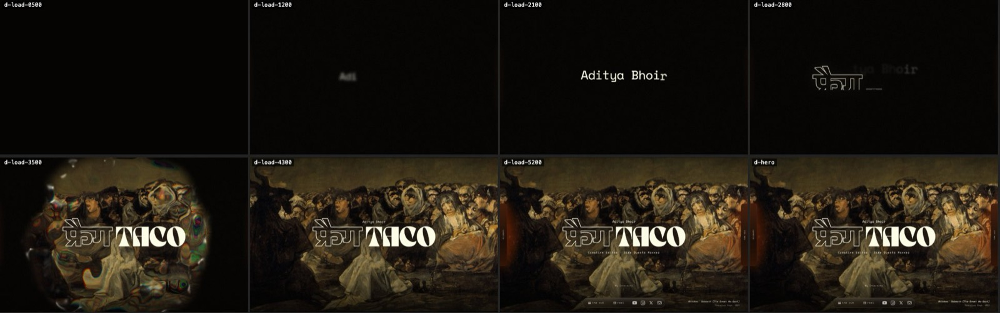
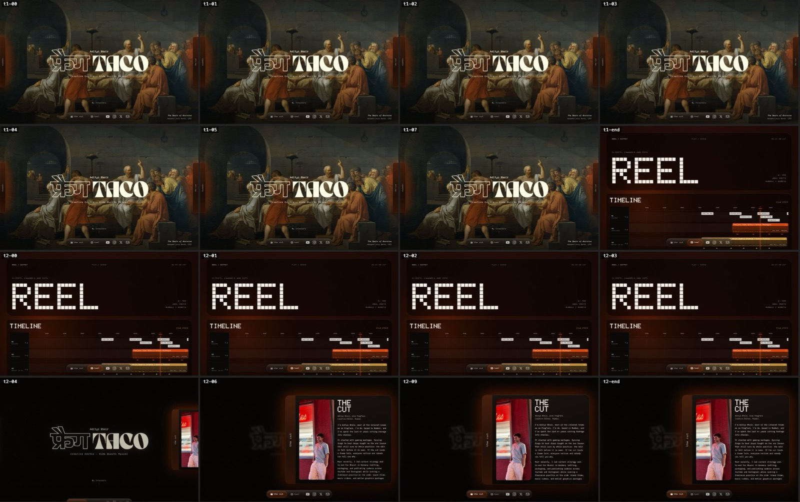
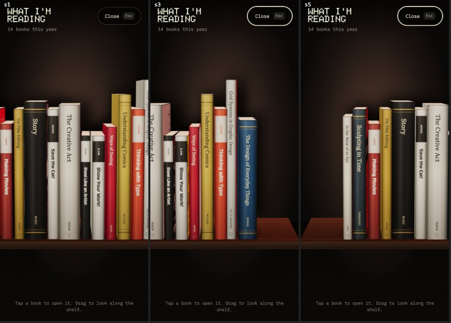

# Site audit, 11 November 2026

What is wrong or weak on the live site today, with evidence, how serious it is, and the direction of the fix. This is the input to the polish pass in the [design outline](../superpowers/specs/2026-11-11-polish-and-work-page-design.md) and the [build plan](../superpowers/plans/2026-11-11-polish-and-work-page.md).

**Audited:** https://fragtaco-portfolio.vercel.app (branch `redesign/r30-finish`, commit `3a618e9`), in headless Chrome on a real GPU at 1440x900 and 390x844 (phone, touch, 3x screen), each run on a fresh profile so nothing was cached. The code was read alongside.

**Rule for the polish pass (Aditya, round 5):** balance and clean up so it looks finished. Do not change so much that the site looks different.

Severity: **High** = a visitor can get stuck or sees something broken. **Medium** = looks unfinished or feels slow. **Low** = tidy-up.

## Summary

| Area | High | Medium | Low |
| --- | --- | --- | --- |
| Loader and hero | 3 | 4 | 2 |
| Dock and page changes | 2 | 3 | 1 |
| Cards | 0 | 3 | 2 |
| My Interests blocks | 0 | 3 | 1 |
| Reading shelf | 2 | 4 | 2 |
| Watching wall | 1 | 5 | 2 |
| Type and colour | 0 | 3 | 1 |
| Phone | 2 | 3 | 0 |
| Code and assets | 0 | 6 | 9 |

The three that matter most:

1. **The loader can hold the page hostage.** On a cold load the first painting (0.3 to 2.1 MB) sometimes takes more than ten seconds. The page stays on the logo, locked, until it arrives or 16 seconds pass (L-01).
2. **Coming back from the work page shows a black hero** with no painting for at least three seconds (N-02).
3. **The shelf and the wall can open empty** for five seconds or more on the live site, with nothing to say they are loading (S-01, W-01).

## Loader and hero

| ID | Severity | What happens | Evidence | Fix direction |
| --- | --- | --- | --- | --- |
| L-01 | High | The reveal waits for the first painting. On a cold load this took over 10 s in 4 of 7 runs, on phone and desktop. The page is scroll-locked the whole time; the head-script failsafe unlocks at 15 s onto a black hero. | Image request set at 2.4 s, still not loaded at 13 s; `html.intro` still present at 9.6 s on desktop. | Smaller files (L-02), start the download from the HTML (L-03), reveal a blurred placeholder when the full image is late, and never hold the lock past the normal loader length. |
| L-02 | High | Paintings are heavy. The 2560 px copies are 1.4 to 2.1 MB each, the 1600 px copies 0.26 to 0.73 MB. | `public/paintings/2560/school-of-athens.jpg` is 2,140,638 bytes. | Re-encode: 1600 px at about 250 KB, 2560 px at about 600 KB (WebP with JPEG fallback, or JPEG quality about 70). Add a 24 px blurred placeholder per painting. |
| L-03 | High | The first painting is chosen in the browser after the JavaScript loads, so its download starts 2.4 to 3.5 s after navigation. | `src` first set at 2,449 ms (phone) and 3,458 ms (desktop). | Choose the first painting on the server and preload it from the HTML head with high priority. |
| L-04 | Medium | The first second or more is a blank black screen: the name animation only starts after the JavaScript loads (about 2.4 s cold). | Frame at 0.5 s is empty; "Adi" appears at 1.2 s on a warm load. | Start the name with CSS from the first paint; JavaScript joins the timeline in progress. |
| L-05 | Medium | The name leaving and फ्रैग arriving overlap in the same spot for about 0.7 s, which reads as a smear. | Frame at 2.8 s shows "tya Bhoir" blurred over the rising logo. | Finish the name's exit before the logo starts (shift the exit about 250 ms earlier). |
| L-06 | Medium | Returning visitors in the same tab (loader skipped) see a black hero until the painting loads. | Same cause as N-02. | Show the placeholder at once, then the painting. |
| L-07 | Medium | Paintings change every 15 to 20 s. Aditya wants 10 s. | `nextDelayMs` returns 15000 to 20000. | 10 s between changes; shorten the slow zoom to match. |
| H-01 | Medium | The rails that hint at the two cards are unreadable: their labels render at 9 px. Nothing tells a visitor the cards exist. | Rail text is 16 px inside a card scaled to 0.56. | Keep the label at a readable 13 px whatever the card's scale; rename the right rail (see N-04). |
| H-02 | Low | "My Interests" is 11.5 px at 60% opacity, the smallest, faintest thing on the hero, yet it is the only pointer to half the page. | Computed style. | 13 px at 75%. |
| H-03 | Low | The फ्रैग outline is visually lighter than the solid TACO beside it. | Hero screenshot. | Leave as is (signed off); listed so nobody "fixes" it. |

## Dock and page changes

| ID | Severity | What happens | Evidence | Fix direction |
| --- | --- | --- | --- | --- |
| N-01 | High | Clicking "reel" does nothing visible for about 420 ms, then the page cuts hard to the work page. | Frames 0 to 7 after the click are unchanged. | Preload the other page when the pointer reaches the dock; quick blur transition between pages. |
| N-02 | High | Clicking back to home cuts to a black hero: logo on black, no painting, for the whole 2.8 s captured. | Frames `t2-04` to `t2-end`. | Keep the last painting in memory across pages and show it immediately; placeholder as the fallback. |
| N-03 | Medium | "the cut" opens the intro card. Aditya: this is wrong; the tab should go to the hero and be called "home". | Round 5. | Rename, new icon, go to the hero (close any card or layer, scroll to top). |
| N-04 | Medium | "reel" should read "work". With the dock tab renamed, the intro card's rail still says "the cut", the same words as its own heading. | Round 5. | Dock: home, work. Right rail: "about". |
| N-05 | Medium | The tab title uses an em dash ("FragTaco — Aditya Bhoir", "Reel — FragTaco"), against the site's own copy rule. | `app/root.tsx:34`, `app/routes/_index.tsx:8`, `app/routes/work.tsx:8`. | "FragTaco - Aditya Bhoir", "Work - FragTaco". |
| N-06 | Low | After closing a layer with the mouse, the block keeps an orange outline. | Screenshot after close. | Show focus rings only for keyboard focus. |

## Cards

| ID | Severity | What happens | Fix direction |
| --- | --- | --- | --- |
| C-01 | Medium | Body copy is 13.5 px, small for a 1000 px wide card on a desktop screen. | 15 px on desktop, 14 px on phones, line height 1.7. |
| C-02 | Medium | Secondary text sits at 42 to 50% opacity (close hint, link values, list labels), below readable contrast at 11 to 12.5 px. | Nothing meant to be read goes below 62%. |
| C-03 | Medium | With a card open, "My Interests" still shows under the card's edge. | Hide the cue and caption while a card is open (they are dimmed today, not hidden). |
| C-04 | Low | The credits portrait is a 1.26 MB PNG shown at 110 px. | Resize to a 220 px JPEG. |
| C-05 | Low | On a phone held sideways the cards are only 183 px tall. | Let the card use the full height between the top edge and the dock in landscape. |

## My Interests blocks

| ID | Severity | What happens | Evidence | Fix direction |
| --- | --- | --- | --- | --- |
| B-01 | Medium | The section is not balanced vertically: 90 px above the blocks, 168 px below, and the page ends there. | Blocks at y 102 to 732 in a 888 px section. | Equal space above and below; the dock's band counts as part of the lower space. |
| B-02 | Medium | The two previews do not match: the mini shelf fills 60% of its block's width, the mini wall fills all of it. | Blocks screenshot. | Centre the mini shelf on the block and let it span the same inner width as the wall preview. |
| B-03 | Medium | Titles are 63 px and the copy is 13.5 px, with nothing in between. | Computed styles. | Titles `clamp(40px, 3.6vw, 56px)`, copy 15 px. |
| B-04 | Low | The count line reads "14 books this year" even if there were one ("1 books"). | `interest-blocks.tsx:118,164`. | Pluralise. |

## Reading shelf

| ID | Severity | What happens | Evidence | Fix direction |
| --- | --- | --- | --- | --- |
| S-01 | High | On the live site the shelf can open onto an empty wall for five seconds or more. three.js (176 KB gzipped) and about 75 textures are prepared in idle slices that mostly time out at 1.2 s each while the page is busy. | Books began to drop about 6 s after the click. | Show a placeholder shelf at once; when the layer is open and waiting, prepare without idle slicing. |
| S-02 | High | On a narrow screen the shelf is clipped and can only be moved by touch. A mouse cannot drag it and a trackpad cannot scroll it, so in a narrow desktop window (or a phone preview without touch) half the books are unreachable. This is what Aditya saw. | Touch drag works in emulation (image above); `pointermove` ignores `pointerType === "mouse"`. | Drag with any pointer, horizontal wheel and trackpad pan, pointer capture, momentum on release, and a position marker. Check on a real iPhone. |
| S-03 | Medium | During the drop-in the books tilt in different directions and pass through each other. | Frames `d-open-a` to `d-open-d`. | Drop straight: no tilt, a shorter fall, the same stagger. |
| S-04 | Medium | Closing the layer fades the shelf out while the layer shrinks, so for a few frames a ghost of the shelf hangs over the page. | Frame `d-close-b`. | Fade the scene out first (120 ms), then shrink. |
| S-05 | Medium | The header has no backing on phones: the title sits on top of the books. | Phone shelf screenshot. | A short dark fade behind the header. |
| S-06 | Medium | "Esc" is shown on the Close button on touch screens, which have no Esc key. | Phone screenshots. | Hide the key hint on touch devices. |
| S-07 | Low | The opened book's blur canvas is reallocated on every open. | Review note, Task 14. | Reallocate only when the size changes. |
| S-08 | Low | The engine file is 868 lines doing four jobs. | `shelf-engine.ts`. | Split (see K-02). |

## Watching wall

| ID | Severity | What happens | Evidence | Fix direction |
| --- | --- | --- | --- | --- |
| W-01 | High | On a phone the wall was still an empty dark panel six seconds after opening. | Phone capture `m-wall2`. | Same as S-01: placeholder at once, urgent preparation, tiles fade in as they load. |
| W-02 | Medium | The wall is flat: every tile is the same size, at the same depth, moving at the same speed. Aditya: it should have more depth and feel alive, not like a generic wall. | Round 5. | Two depth planes with parallax, a pointer parallax, a "same channel" echo, and a loading fade. See the design outline. |
| W-03 | Medium | The header runs over the thumbnails with no backing; the Close button sits on a thumbnail. | Wall screenshot. | Dark fade behind the header, as for the shelf. |
| W-04 | Medium | On a phone, with a video open, the layer's Close button and the detail's close button overlap in the same corner. | Phone capture `m-detail`. | Hide the layer header while a video is open. |
| W-05 | Medium | Thumbnails pop in at full brightness as they load. | Watching a cold open. | Each tile fades and settles in over 300 ms. |
| W-06 | Medium | A right-click or a second finger opens a video. | Review note, Task 16. | Primary button and primary pointer only. |
| W-07 | Low | The visible hint never mentions the keyboard. | Review note, Task 16. | Add "Arrow keys and Enter work too" on devices with a keyboard. |
| W-08 | Low | If the graphics context is lost the wall stays blank. | Review note, Task 16. | Switch to the plain grid when the context is lost. |

## Type and colour

| ID | Severity | What happens | Fix direction |
| --- | --- | --- | --- |
| T-01 | Medium | Eleven different small sizes are in use between 10.5 and 18 px (10.5, 11, 11.5, 12, 12.5, 13, 13.5, 14, 14.5, 16, 18). Nothing is wrong with any one of them; together they look undecided. | Five named sizes: 12, 13, 15, 18 px and the display scale. Everything maps to one of them. |
| T-02 | Medium | Body copy across the site is 12.5 to 13.5 px on desktop. | Body is 15 px on desktop and 14 px on phones. |
| T-03 | Medium | Seven opacity levels for secondary text (42, 45, 50, 52, 55, 60, 62%). | Three levels: 92% (primary), 72% (secondary), 62% (quiet). |
| T-04 | Low | The design doc says the roles line is Space Mono; the signed-off mockup and the site use IBM Plex Mono. | Correct the doc; the site is right. |

## Phone

| ID | Severity | What happens | Fix direction |
| --- | --- | --- | --- |
| M-01 | High | The loader hang (L-01) is worst on phones: slower networks, and the lock means the visitor cannot even scroll. | As L-01. |
| M-02 | High | Shelf clipped with no way to move it without touch (S-02). | As S-02. |
| M-03 | Medium | Header and close controls collide on the wall (W-04) and sit on the content (S-05, W-03). | As listed. |
| M-04 | Medium | The dock's 14 px Doto labels at 70% are hard to read on a phone. | 85% when idle, 100% when active. |
| M-05 | Medium | Not yet checked on real hardware: a mid-range Android phone and an iPhone. | Aditya's device check, with a written checklist. |

## Code and assets

| ID | Severity | What | Fix direction |
| --- | --- | --- | --- |
| K-01 | Medium | `home.css` is 1,614 lines holding seven unrelated areas. | One stylesheet per area plus a tokens file. |
| K-02 | Medium | `shelf-engine.ts` (868 lines) and `wall-engine.ts` (796 lines) each mix scene building, texture loading, input and the frame loop. | Split each into scene, textures, input and loop modules. |
| K-03 | Medium | `hero.tsx` (477 lines) has one 290-line effect; `home-page.tsx` (380 lines) holds the layer's history logic inline; `use-card-gestures.ts` has one 180-line effect. None of that logic can be unit-tested where it sits. | Extract hooks and pure helpers with tests. |
| K-04 | Medium | 116 small review notes were deferred during the build, now listed in [deferred-review-notes.md](deferred-review-notes.md). | Each one is either fixed in the task that touches its file or closed with a reason. The plan carries the list. |
| K-05 | Medium | The old work page (1,981 lines in `app/components/projects/`) and three orphaned files (`app/components/about/*`, unused entries in `app/config/ui.ts`, `getNavHeight`) are still in the tree. | Delete when the new work page lands; delete the orphans now. |
| K-06 | Medium | The plan's second half of R30 (accessibility pass, measurements in the docs, final review) was never run, and the R30 pull request is not open. | Folded into this plan. |
| K-07 | Low | `public/background.png` (3.8 MB) is referenced by nothing. | Delete after confirming. |
| K-08 | Low | The `inert` helper exists twice (`card-shell.ts`, `site-nav.tsx`). | One shared helper. |
| K-09 | Low | Z-index values are scattered. | One documented scale in the tokens file. |
| K-10 | Low | `@vercel/remix` 2.16.7 warns about its peer versions against Remix 2.17.4. | Leave; note in the README. Revisit when a 2.17 preset exists. |
| K-11 | Low | The sync script: any non-200 thumbnail check is stored as "hq"; a corrupt `videos.json` aborts the run; the write is not atomic; one unavailable video blocks the whole sync; playlists over 100 are cut off silently. | Fix all five in one task. |
| K-12 | Low | Tests that cannot fail or assert loosely (noted in reviews of Tasks 3, 8, 13, 15, 18). | Tighten in the task that touches each file. |
| K-13 | Low | `LayerControlContext` defaults to a silent no-op. | Throw when used outside its provider. |
| K-14 | Low | The README does not describe the new home page, the sync command or deployment. | Rewrite at the end. |
| K-15 | Low | `/work` requests ten client images that do not exist (404s). | Goes away with the new work page. |

## What is working and must not change

- The look: paintings, the lockup, Doto and the two mono faces, the orange accent, the dot-and-grain texture.
- The liquid-glass reveal and sweep.
- Card behaviour: keys, swipe, drag, the blurred hero behind.
- The layer growing out of its block, with its own link and history.
- A book sliding out before it turns; the blurred shelf behind an open book.
- The wall's flat, sharp focus with the orange glow.
- Measured smoothness: no frame over 20 ms in any animated scenario at 60 Hz once content is loaded.
